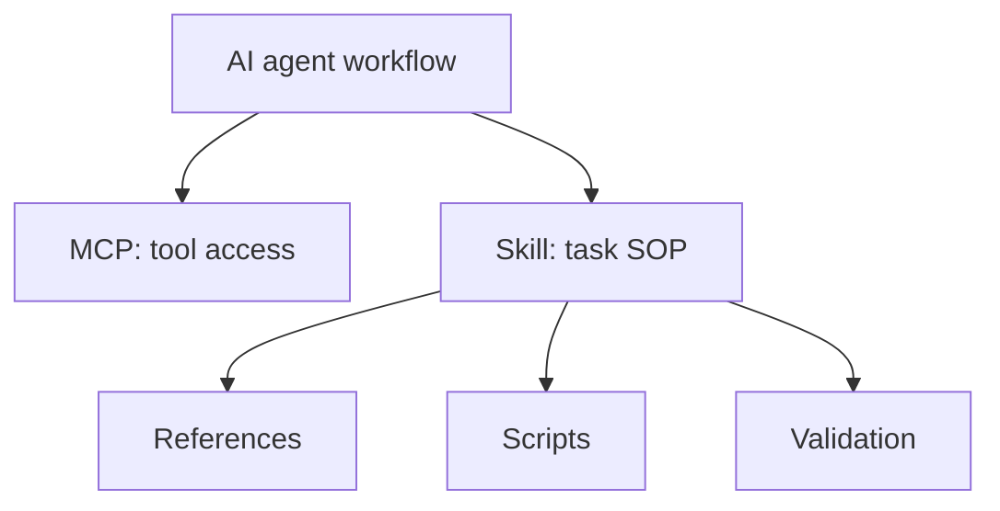

# Example Output: Study Notes Outline

## 思维导图

## 复习路径

Read the mindmap, the core conclusion, and the active recall questions.

## 核心结论

**MCP answers "what can the agent access"; Skills answer "how should the agent complete the task."**

## 主动回忆自测

1. What problem does MCP solve?
2. What problem does a Skill solve?
3. Why do reusable workflows need validation?

## 核心模块

MCP is the access layer. Skill is the reusable workflow layer. Validation is the quality gate that keeps the output useful.

## 项目迁移清单

- Turn repeated work into a `SKILL.md`.
- Move long rules into `references/`.
- Add scripts when validation needs to be deterministic.

## 面试话术

**I use MCP to connect tools and Skills to encode repeatable workflows with quality checks.**

## 资料来源与质量审计

- Sources: synthetic transcript and courseware outline.
- Audit: no private transcript, Feishu/Lark URL, or credential is included.
